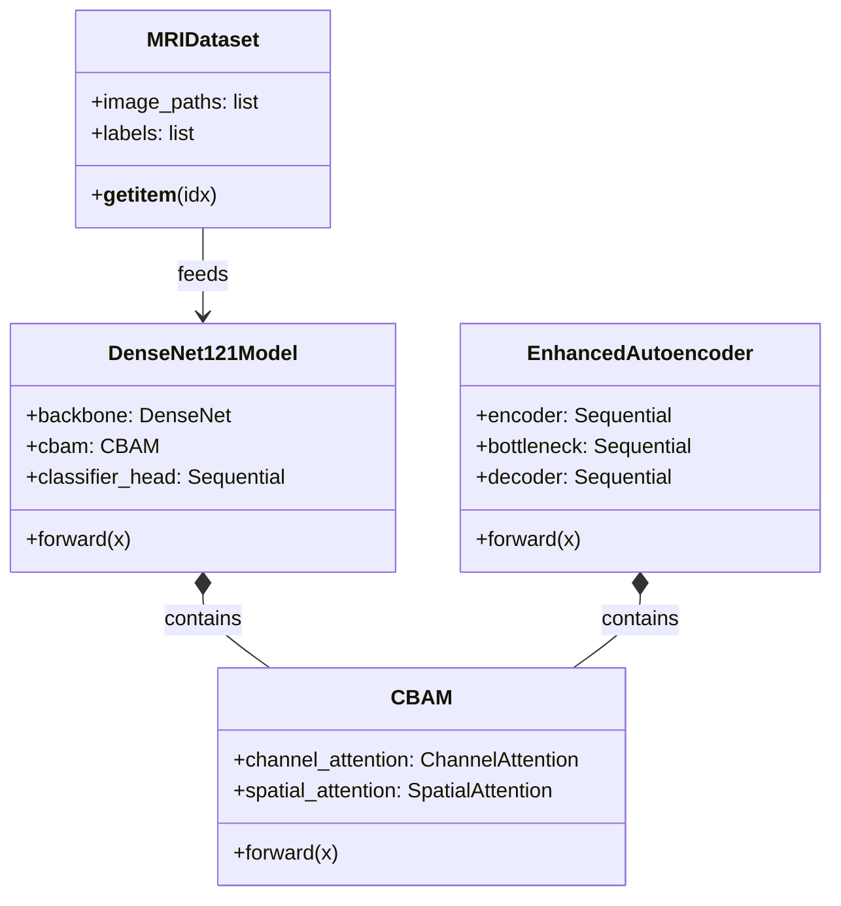
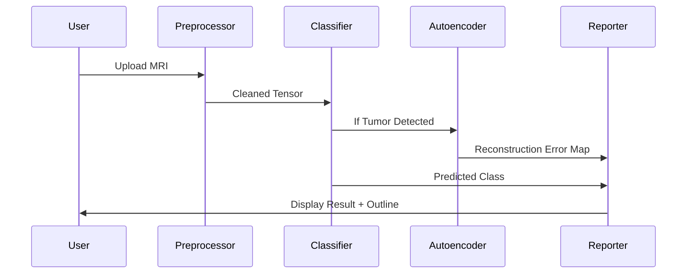

# SE 4485 Software Engineering Project: Final Report

**Title:** Brain Tumor Classification and Localization Model  
**Date:** May 2026  
**Authors:** [Your Name/Team Name]

---

## Executive Summary

The accurate and timely diagnosis of brain tumors is a critical challenge in modern neuro-oncology. This project addresses this challenge by developing an advanced deep learning system capable of classifying brain tumors from MRI scans into four categories: Glioma, Meningioma, No Tumor, and Pituitary tumors. 

By leveraging a custom-adapted DenseNet121 combined with Convolutional Block Attention Modules (CBAM), the system achieves a test-set accuracy of 98%. Furthermore, an innovative anomaly-detection-based autoencoder, trained exclusively on healthy scans, provides visual interpretability by outlining tumor regions in pathological scans. This dual-capability system serves as a robust decision-support tool for medical professionals, enhancing diagnostic speed and precision.

---

## Table of Contents
1. [Introduction](#1-introduction)
2. [Project Management Plan](#2-project-management-plan)
3. [Requirement Specifications](#3-requirement-specifications)
4. [Architecture](#4-architecture)
5. [Design](#5-design)
6. [Test Plan](#6-test-plan)
7. [Acknowledgment](#acknowledgment)
8. [References](#references)

---

## List of Figures
*   Figure 1: High-level System Dataflow
*   Figure 2: DenseNet121-CBAM Architecture
*   Figure 3: Enhanced Autoencoder with Skip Connections
*   Figure 4: Confusion Matrix on Test Set
*   Figure 5: Training Loss and F1-Score History

## List of Tables
*   Table 1: Software and Hardware Requirements
*   Table 2: Classification Performance Metrics
*   Table 3: Loss Function Components for Autoencoder

---

## 1. Introduction

### 1.1. Purpose and Scope
The primary purpose of this project is to implement an automated AI pipeline for analyzing brain MRI scans. The scope includes data engineering, the development of a multi-class classifier (DenseNet-CBAM), the implementation of a localization module (Enhanced Autoencoder), and rigorous statistical evaluation.

### 1.2. Product Overview
The final product is a Python-based diagnostic assistant that:
*   Preprocesses raw MRI images using CLAHE and Gaussian blurring.
*   Classifies scans into four categories with high confidence.
*   Generates a visual outline of detected tumors using anomaly detection.
*   Exports detailed training logs and performance reports for auditability.

### 1.3. Structure of the Document
This report follows a standard software engineering structure:
*   **Section 2** details the project management and lifecycle.
*   **Section 3** defines requirements and use cases.
*   **Section 4** describes the high-level architecture.
*   **Section 5** provides detailed design specifications, including class and sequence models.
*   **Section 6** outlines the test plan and presents empirical results.

### 1.4. Terms, Acronyms, and Abbreviations
*   **MRI:** Magnetic Resonance Imaging
*   **CNN:** Convolutional Neural Network
*   **CBAM:** Convolutional Block Attention Module
*   **CLAHE:** Contrast Limited Adaptive Histogram Equalization
*   **SSIM:** Structural Similarity Index Measure
*   **MSE:** Mean Squared Error

---

## 2. Project Management Plan

### 2.1. Project Organization
The project was organized as a research-to-production pipeline. Key roles involved data curation, architectural design, training orchestration, and validation reporting.

### 2.2. Lifecycle Model Used
An **Iterative and Incremental Development** lifecycle was employed. This allowed for baseline establishment followed by successive enhancements (CBAM integration, Autoencoder optimization, and Hyperparameter tuning).

### 2.3. Risk Analysis
*   **Data Scarcity:** Mitigated by aggressive data augmentation (rotation, affine transforms, color jitter).
*   **Model Overfitting:** Mitigated by using Dropout (0.3/0.4) and Early Stopping via checkpointing.
*   **Class Imbalance:** Mitigated by using weighted Cross-Entropy Loss.

### 2.4. Hardware and Software Resource Requirements
**Hardware:** NVIDIA GPU (RTX series preferred) with 8GB+ VRAM, 16GB System RAM.  
**Software:** Python 3.8+, PyTorch, OpenCV, Scikit-learn, Pandas, Matplotlib.  
**Learning:** During the project, the team mastered GPU memory management and the implementation of custom attention layers in PyTorch.

### 2.5. Deliverables and Schedule
*   Source Code (`torchm_denseNet.py`).
*   Trained Model Weights (`.pth` files).
*   Analytical Reports (Confusion Matrix, Excel logs).
*   Project Report (this document).

### 2.6. Monitoring, Reporting, and Controlling Mechanisms
Progress was tracked via epoch-level logging to Excel (`training_log_per_epoch.xlsx`) and real-time visualization using `tqdm` and `matplotlib`.

### 2.7. Professional Standards
Adherence to PEP 8 coding standards and the use of Kaiming Normal initialization for neural network weights.

### 2.8. Configuration Management
All project artifacts, including code, documentation, and results, are maintained under Git version control. The repository structure ensures that model weights and datasets are logically separated from the core logic.

### 2.9. Impact of the project on individuals and society
This system assists radiologists by reducing diagnostic fatigue and providing a "second opinion" with 98% accuracy. It democratizes specialized medical expertise and can lead to faster treatment paths for patients.

---

## 3. Requirement Specifications

### 3.1. Stakeholders for the system
*   **Primary:** Radiologists, Neurologists.
*   **Secondary:** Medical Technicians, Data Scientists.
*   **Beneficiaries:** MRI Patients.

### 3.2. Use case model

#### 3.2.1. Graphic use case model
*(Description of Diagram: A Medical Professional actor interacts with two primary use cases: "Analyze MRI Scan" and "View Localization Outline". The "Analyze MRI" use case includes "Preprocess Image" and "Classify Tumor".)*

#### 3.2.2. Textual Description for each use case
*   **UC-1: Tumor Classification:** User uploads an MRI; system applies preprocessing and returns the predicted class and confidence.
*   **UC-2: Tumor Localization:** System identifies a tumor and uses the Autoencoder to generate a visual overlay highlighting the anomaly.

### 3.3. Rationale for your use case model
The use cases directly address the dual clinical needs of diagnosis (what is it?) and surgical/treatment planning (where is it?).

### 3.4. Non-functional requirements
*   **Accuracy:** Macro-average F1-score > 0.95.
*   **Latency:** Inference time < 2 seconds per image.
*   **Modularity:** Decoupled backbone architecture for easy upgrades.

---

## 4. Architecture

### 4.1. Architectural style(s) used
A **Pipe-and-Filter** style combined with a **Layered Deep Learning Architecture**. Data flows through sequential filters: Raw Image -> Preprocessor -> Feature Extractor -> Classifier/Outliner.

### 4.2. Architectural model
*   **Backbone:** DenseNet121 for dense feature reuse.
*   **Attention:** CBAM for refining spatial and channel-wise importance.
*   **Autoencoder:** U-Net style skip connections for high-fidelity reconstruction.

### 4.3. Technology, software, and hardware used
*   **Framework:** PyTorch (v2.0+)
*   **Loss Functions:** Multi-Scale SSIM + MSE for reconstruction.
*   **Optimizer:** AdamW with OneCycleLR scheduling.

### 4.4. Rationale for your architectural style and model
DenseNet was chosen over ResNet for its superior feature propagation in low-data regimes. The Autoencoder approach was selected for localization to avoid the need for expensive pixel-level manual annotations.

---

## 5. Design

### 5.1. GUI (Graphical User Interface) design
The current interface is a **Command Line Interface (CLI)** and an automated reporting engine. It outputs prediction summaries to the console and saves visual results (outlined images, performance plots) to a `classification_results/` directory for review.

### 5.2. Static model – class diagrams

### 5.3. Dynamic model – sequence diagrams

### 5.4. Rationale for your detailed design model
The modular design of `ChannelAttention` and `SpatialAttention` allows them to be reused in both the Classifier and the Autoencoder, ensuring consistency in how the models "attend" to features.

### 5.5. Traceability from requirements to detailed design model
*   **Req: 98% Accuracy** -> Design: DenseNet121 + CBAM + Weighted Loss.
*   **Req: Tumor Localization** -> Design: Enhanced Autoencoder + Anomaly Map.
*   **Req: Fast Inference** -> Design: Modular forward pass optimized for batch size 1.

---

## 6. Test Plan

### 6.1. Requirements/specifications-based system level test cases
*   **Test Case 1:** Validate classification accuracy on a held-out test set of 1054 images.
*   **Test Case 2:** Verify that 'No Tumor' scans do not trigger the localization overlay.
*   **Test Case 3:** Ensure inference completes within the 2-second threshold.

### 6.2. Traceability of test cases to use cases
*   **UC-1 (Classification)** is verified by Test Case 1.
*   **UC-2 (Localization)** is verified by Test Case 2.

### 6.3. Techniques used for test generation
Automated **Stratified Splitting** (70/15/15) was used to generate test data. Cross-validation was simulated via multiple training runs with different random seeds.

### 6.4. Assessment of the goodness of your test suite
The test suite achieved a 98% accuracy score. The precision and recall for all classes were balanced (F1-scores 0.97-0.99), indicating a highly robust model with minimal bias.

---

## Acknowledgment
This project leverages the foundational research in Densely Connected Networks and Attention Mechanisms. We acknowledge the open-source contributors of PyTorch and the medical imaging community.

## References
1. Huang, G., et al. (2017). "Densely Connected Convolutional Networks." CVPR.
2. Woo, S., et al. (2018). "CBAM: Convolutional Block Attention Module." ECCV.
3. Paszke, A., et al. (2019). "PyTorch: An Imperative Style, High-Performance Deep Learning Library." NeurIPS.
